# Project ANU — Click-by-click flowchart book

Reviewed 30 October 2026. This expands the earlier architecture flow into individual UI actions. Every named edge is a click, input, choice or explicit automatic event. Read each screen separately; the same flow applies to each repeated table row.

**Scope:** current React LMS frontend and its handlers, plus the documented headset API boundary. The Unity/headset source is not present in this reviewed frontend, so a complete headset-button sequence cannot be asserted. Registered routes, conditional UI, dialogs defined without visible openers, placeholders and controls without handlers are distinguished explicitly. This is static source analysis, not a browser walkthrough or a guarantee that the deployed application behaves identically.

**Cost markers:** C1 = API/backend; C2 = database; C3 = object storage, file requests and delivery; C4 = conversion compute; C5 = IVS live participant time; C6 = email/SMS provider. Unmarked view toggles are local unless their hosting component triggers a subsequent fetch. The pricing formulas and sources are in [the cloud-cost guide](ANU_USER_FLOWS_AND_CLOUD_COSTS.md). A click does not have a flat cloud price: duration, file size, requests, retention and plan determine the charge.

**How to review:** the HTML action atlas provides a diagram for every extracted control in the reachable source graph, including fields, selectors, table pagination and library component callbacks. It includes source line references, disabled conditions and event handlers for verification. The charts below provide the readable sequential flows; the action atlas is the completeness appendix. Decorative ripple/focus callbacks and generic modal wrappers are recorded as source evidence, not separate business tasks. Conditional and dynamically generated controls may have different labels at runtime.

## 01. Login: every action

Source: `Auth/login.js` (under `client/src/`).

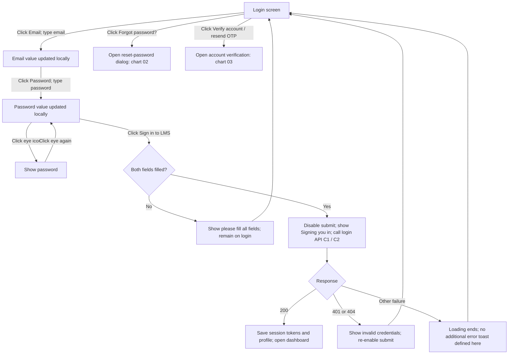


## 02. Forgot-password dialog: every action

Source: `Auth/login.js; utils/ForgotPassword.js` (under `client/src/`).

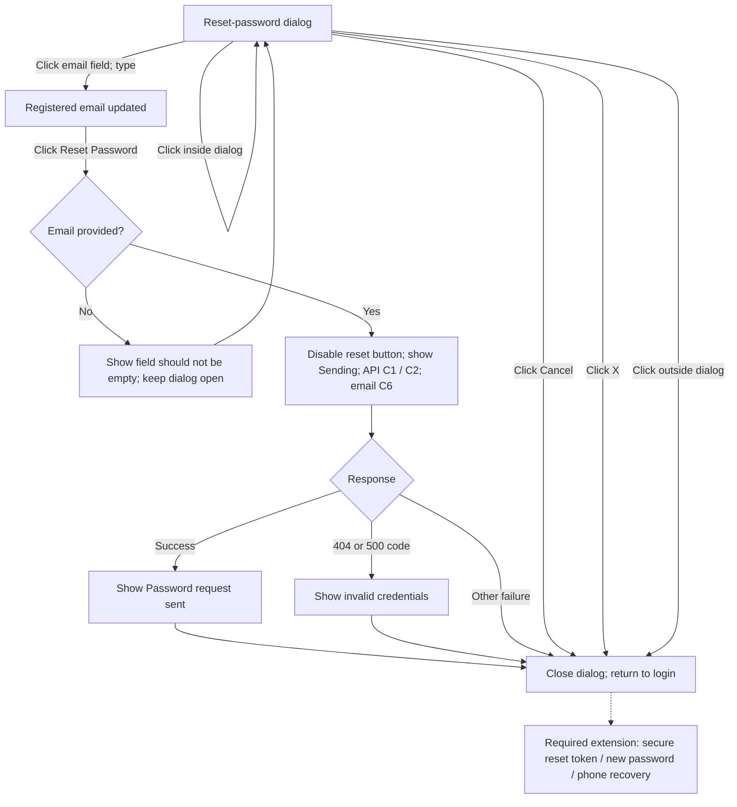

The frontend promises reset instructions, but the reviewed backend sends placeholder email text. The dashed extension is not implemented by these controls.

## 03. Account verification and resend OTP

Source: `Auth/AccountVerification.js` (under `client/src/`).

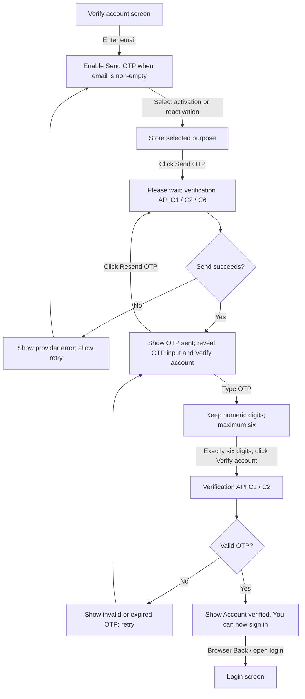

Phone OTP here activates/reactivates an account. It is separate from forgot-password recovery. This screen does not automatically navigate to login after success.

## 04. Shared navigation, notifications, profile and logout

Source: `components/sideBar.js; components/navBar.js; pages/Profile.js` (under `client/src/`).

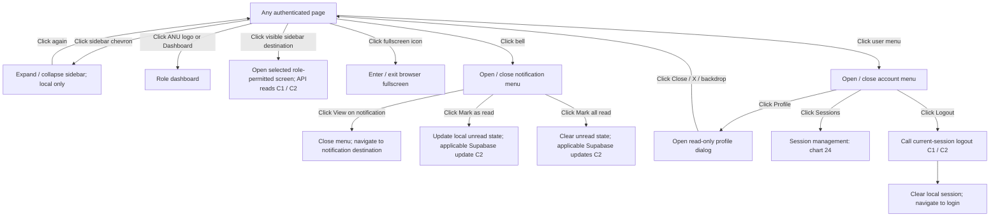


## 05. Role dashboards

Source: `components/admin/AdminDashboard.js; components/superadmin/SuperAdminDashboard.js; pages/TutorDashboard.js; components/trainee/TraineeDashboard.js` (under `client/src/`).

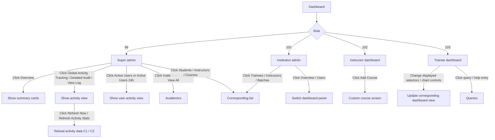


## 06. Trainee list: view, edit, enable, disable and delete

Source: `components/admin/traineeList.js` (under `client/src/`).

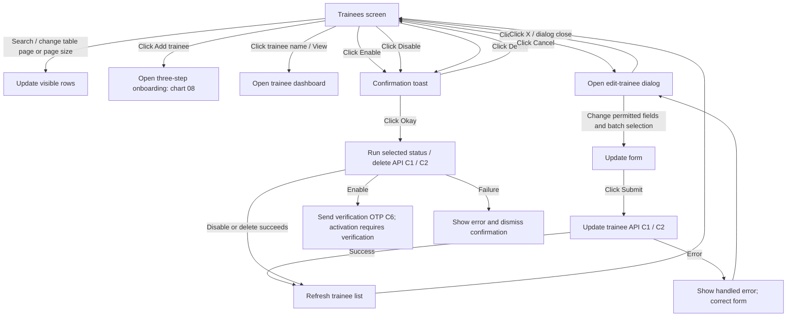


## 07. Instructor list and instructor profile

Source: `pages/Instructors.js; pages/IndividualInstructors.js` (under `client/src/`).

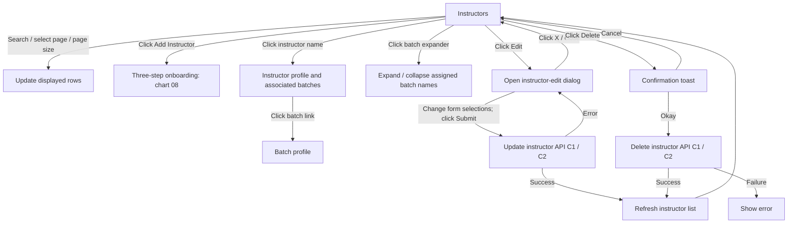


## 08. Add trainee / instructor: step-by-step

Source: `components/admin/addTrainee.js; components/admin/step/AddTraineeStep1.js; components/admin/step/AddTraineeStep2.js; components/admin/step/AddTraineeStep3.js` (under `client/src/`).

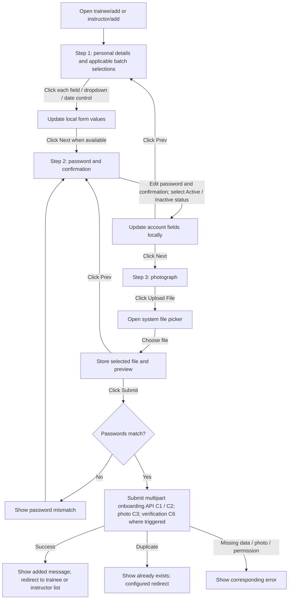

The control appendix lists the exact step fields and disabled conditions. The step navigation should not be interpreted as stronger validation than the source implements.

## 09. Batch list: tabs, create, filter, edit and delete

Source: `pages/Batch.js` (under `client/src/`).

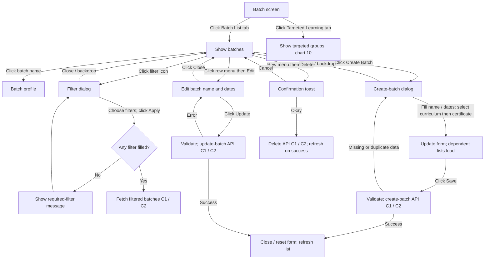


## 10. Targeted learning and batch profile

Source: `pages/Batch.js; pages/BatchIndividual.js` (under `client/src/`).

```mermaid
flowchart TD
 A[Targeted Learning tab] -->|Click create icon| B[Create Targeted Learning dialog]
 B -->|Select curriculum / certificate / modules / resource type / resources| C[Load and update dependent choices C1 / C2]
 C -->|Select assigned users; enter dates and other required details| D[Update local form]
 D -->|Click Initiate| E{Required fields complete?}
 E -->|No| B
 E -->|Yes| F[Create targeted learning API C1 / C2]
 F -->|Success| G[Close dialog; refresh groups]
 F -->|Error| B
 B -->|Click X / backdrop| A
 A -->|Click name / View| H[Batch or targeted-group profile]
 H -->|Click Home| I[Dashboard]
 H -->|Click unbound header sort icon| J[No sorting handler attached]
 A -->|Row menu then Delete| K[Confirmation toast]
 K -->|Cancel| A
 K -->|Okay| L[Delete targeted learning API C1 / C2]
```


## 11. Curriculum

Source: `pages/Curiculum.js` (under `client/src/`).

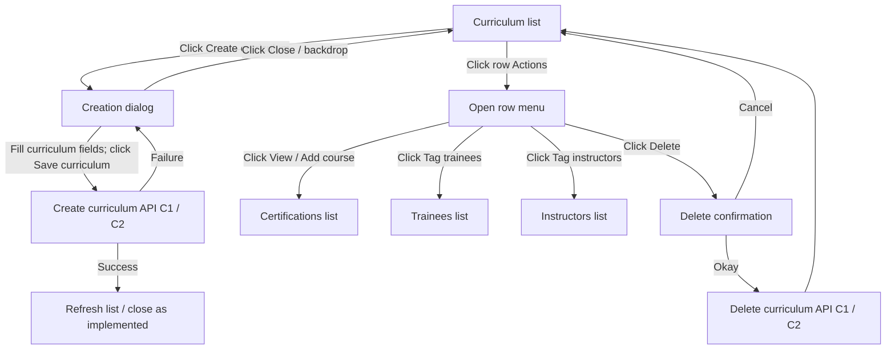


## 12. Certifications: create, expand, view, tag and delete

Source: `pages/Course.js` (under `client/src/`).

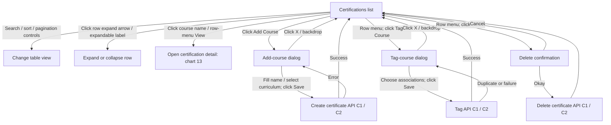


## 13. Certification detail: expand modules, resources and completion

Source: `pages/InsideCertifications.js; components/CreateResources.js` (under `client/src/`).

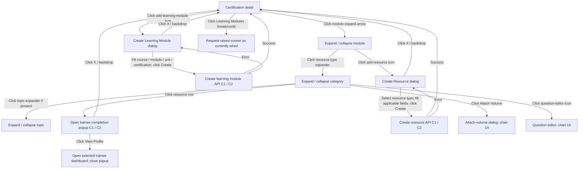


## 14. Attach volume to a learning resource

Source: `pages/InsideCertifications.js` (under `client/src/`).

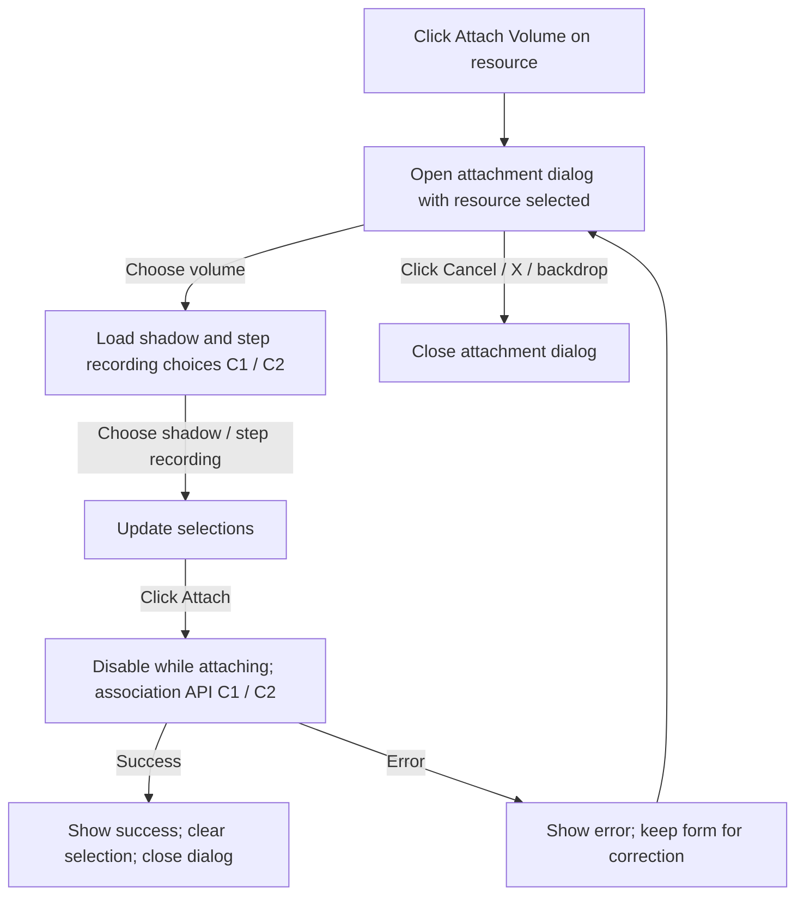


## 15. Question editor: every type of action

Source: `components/MindSparkQuestionModal.js; pages/Resource.js` (under `client/src/`).

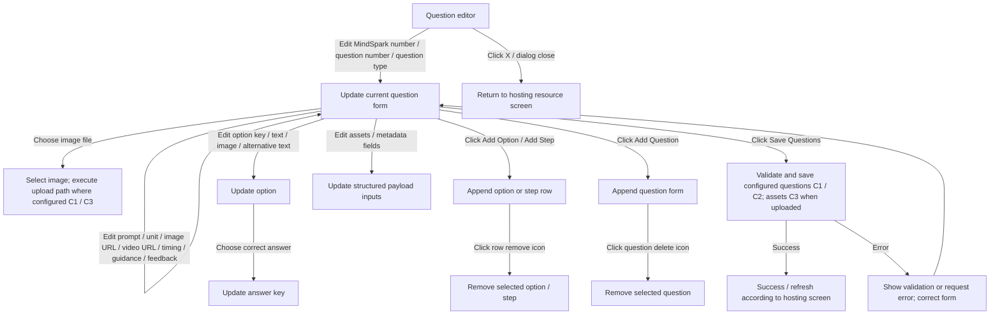

This is content authoring. The learner View Questions dialog is a separate read-only view; do not invent a web quiz-submit button.

## 16. Alternate chapter, module and resource routes

Source: `pages/Chapters.js; pages/Module.js; pages/Resource.js` (under `client/src/`).

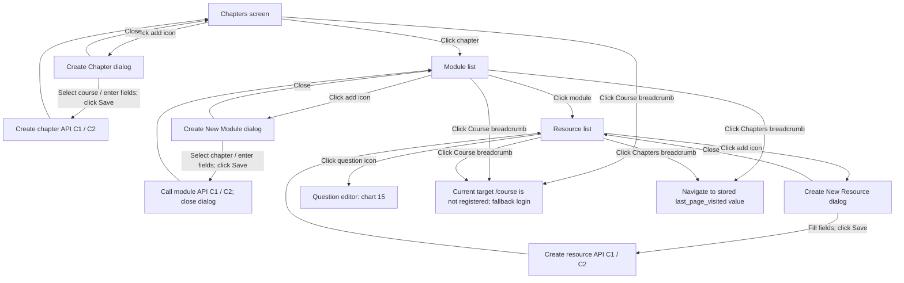

These are registered alternate routes. The modern certification-detail flow is chart 13. The legacy /course breadcrumb target differs from the registered /certificate route.

## 17. Course access, visibility, assignments and migration review

Source: `pages/ContentAccess.js` (under `client/src/`).

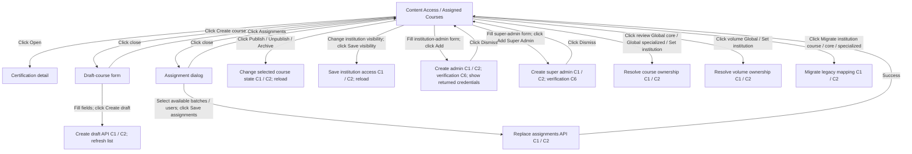

Creation, publishing, assignment and migration actions are conditionally displayed by role. Inspect the role conditions in the source-linked appendix; all actions are not available to every user.

## 18. Volume list: upload, filters, menus and edit

Source: `pages/VolumeList.js` (under `client/src/`).

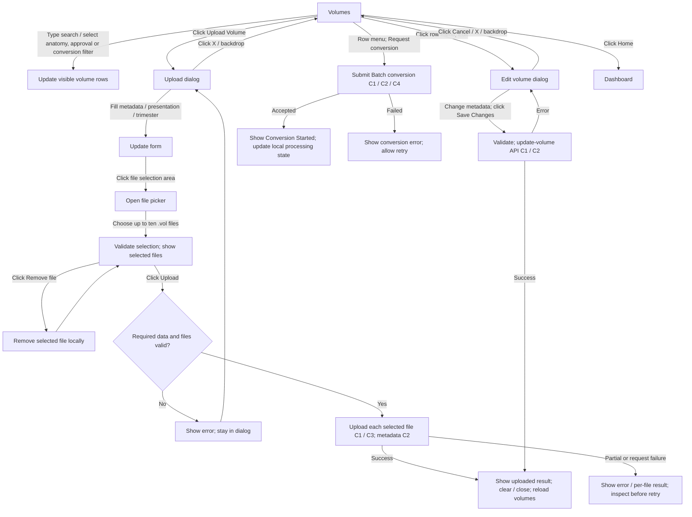


## 19. Volume files: downloads, placement upload and recordings

Source: `pages/VolumeList.js; components/Instructors/VolumeRecordingDownloads.js` (under `client/src/`).

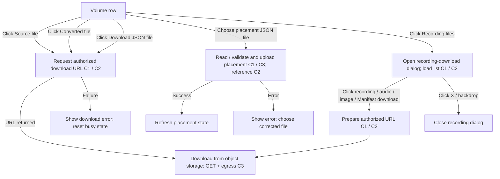


## 20. Cluster management and recording controls

Source: `pages/Cluster.js` (under `client/src/`).

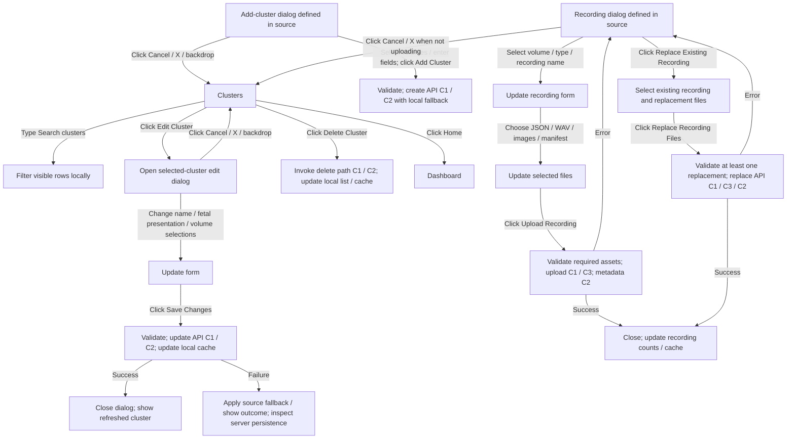

The current rendered cluster table exposes Edit and Delete. Add-cluster and recording dialogs exist in the source, but an opening click was not found in the rendered table/header reviewed. They are shown as separate entry points, not as functioning navigation from the cluster list. Some cluster API failures use local-storage fallback, so a success-looking UI does not prove cloud persistence.

## 21. Course mapping, custom courses and reattempt configuration

Source: `pages/CourseMapping.js; pages/CustomCourse.js; pages/ReattData.js` (under `client/src/`).

```mermaid
flowchart TD
 A[Course Mapping] -->|Choose volume / trimester / module / unit / course type| B[Update form; load dependent recording choices C1 / C2]
 B -->|Choose optional shadow / step recording; click Create Mapping| C[Validate; create mapping C1 / C2]
 C -->|Success| D[Clear form and reload mappings]
 C -->|Error| B
 A -->|Click form Clear| E[Reset form and recording choices locally]
 A -->|Choose list filters; click Apply / Refresh| F[Fetch mappings C1 / C2]
 A -->|Click filter Clear| G[Reset filters and reload as implemented]
 H[Custom Course] -->|Click Add Course| I[Custom-course dialog]
 I -->|Enter details; select volume / course type / recordings| J[Update form]
 J -->|Click Create Course| K[Validate details and trimester; create mapping C1 / C2]
 K -->|Success| H
 K -->|Failure| I
 I -->|Click Clear| L[Reset form and recording choices]
 I -->|Click X / backdrop| H
 H -->|Click Back| M[Dashboard]
 N[Reattempts] -->|Choose certificate / course / unit / resource; edit allowed values| O[Update dependent selections]
 O -->|Click Save| P[Validate; save reattempt configuration C1 / C2]
 N -->|Click Clear| Q[Reset form]
 N -->|Click Refresh / Apply filters| R[Fetch reattempt settings C1 / C2]
 N -->|Click Clear Filters| S[Reset list filters and reload]
```


## 22. My Learning: every navigation and detail action

Source: `pages/MyLearning.js` (under `client/src/`).

```mermaid
flowchart TD
 A[My Learning] -->|Click certification tab| B[Switch certification; choose module; reset filters / search / open topics]
 B -->|Click module| C{Module locked?}
 C -->|Yes| D[Remain on current module]
 C -->|No| E[Switch module; reset local view]
 E -->|Click activity filter / change search| F[Filter visible resources]
 F -->|Click topic header / expander| G[Expand / collapse resource group]
 G -->|Click image-interpretation row| H[Open image-interpretation detail]
 G -->|Click MindSpark row| I[Open configured MindSpark question viewer]
 G -->|Click View Questions| I[Open configured MindSpark question viewer]
 G -->|Click Score| J[Open attempt details without feedback / submission view]
 G -->|Click View| K[Open applicable attempt / feedback / submission details]
 H -->|Click attempt / question expander| L[Expand / collapse details]
 K -->|Click detail tab| M[Switch displayed detail tab]
 K -->|Click User image / Expert image| N[Open asset link; image delivery C3]
 H -->|Click View submitted image| N
 I -->|Click Close / X / backdrop| A
 H -->|Click Close / X / backdrop| A
 J -->|Click Close / X / backdrop| A
 K -->|Click Close / X / backdrop| A
```

The learner controls reviewed show questions, submissions and attempts. Actual VR task performance and submission occur through the headset API contract; the chart does not introduce absent web Start VR / quiz-submit controls.

## 23. My Progress, schedules, queries and reports

Source: `pages/MyProgress.js; pages/Schedules.js; pages/Queries.js; pages/Reports.js` (under `client/src/`).

```mermaid
flowchart TD
 A[My Progress] -->|Click certification tab| B[Switch progress dataset / display]
 C[Schedules] -->|Click Previous period / Next period| D[Move calendar interval]
 C -->|Click Today| E[Return to current date]
 C -->|Click Month / Week| F[Change calendar view]
 C -->|Click calendar event / upcoming event| G[Open associated batch profile]
 H[Queries] -->|Click Create Query| I[Query dialog]
 I -->|Choose type / enter text; click Submit| J[Create query API C1 / C2]
 J -->|Success| K[Close / refresh query list]
 J -->|Error| I
 I -->|Click X / backdrop| H
 H -->|Click row menu then View| L[Close menu only; no detail view opened in current handler]
 H -->|Click Mark as Resolved| M[Update status API C1 / C2; refresh]
 H -->|Click Delete| N[Delete query API C1 / C2; refresh]
 H -->|Change table pagination| O[Update displayed rows]
 P[Reports] -->|Change active date controls| Q[Update selected dates where handlers exist]
 P -->|Click unbound report / filter button| R[No attached action handler found]
```


## 24. Device sessions and forced logout

Source: `pages/Sessions.js; routes/ProtectedRoutes.js` (under `client/src/`).

```mermaid
flowchart TD
 A[Sessions] -->|Type user search when permitted| B[Fetch matching users C1 / C2]
 B -->|Select user| C[Load that user's permitted sessions C1 / C2]
 A -->|Click Previous / Next / page number| D[Change local displayed session page]
 C -->|Click active session Logout| X{Confirm browser dialog?}
 X -->|Cancel| A
 X -->|OK| E[Run per-session termination handler C1 / C2]
 E -->|Success| F[Reload session list]
 E -->|Failure| G[Show error]
 A -->|Click Logout all sessions| Y{Confirm browser dialog?}
 Y -->|Cancel| A
 Y -->|OK| H[Run all-session termination handler C1 / C2]
 H -->|Current user's sessions ended| I[Clear local session; open login]
 H -->|Other permitted user's sessions ended| F
 J[Authenticated page] -->|Automatic 10-second heartbeat / focus check| K[Validate session C1 / C2]
 K -->|401 / 403| I
 J -->|Session revoked socket event| I
```

Session buttons are disabled while busy/loading or when no applicable active session exists. The source-linked atlas includes these exact conditions. Automatic heartbeat requests also incur usage although no user clicks them.

## 25. Streams: trainee preview and admin selection

Source: `pages/Stream.js; components/streaming/TraineeStreamPanel.js; components/streaming/AdminStreamPanel.js` (under `client/src/`).

```mermaid
flowchart TD
 A[Click Streams] --> B{Role}
 B -->|103| C[Open trainee self-preview; request viewer token C1 / C2]
 C --> D{Headset stream available?}
 D -->|Yes| E[Connect to private IVS stage; participant time C5]
 D -->|No| F[Show waiting / unavailable state]
 E -->|Click Enable audio / Mute audio| G[Toggle local preview audio]
 E -->|Click Reconnect preview when displayed| H[Increment attempt; reconnect viewer C1 / C2 / C5]
 H --> D
 B -->|101| I[Open institution monitoring; load stage / stream state C1 / C2 / C5]
 I -->|Click LIVE trainee tile| J[Select displayed trainee stream]
 B -->|Other role| K[Redirect to dashboard]
 L[Headset starts publishing via headset API] --> M[Private IVS publisher; center replication C5]
 M --> E
 M --> I
```

The web screen does not supply a headset Start Publishing click. That click sequence needs the Unity/headset source. Live participant-hour charges continue while connected, even without additional clicks.

## 26. Academics: onboard, filters and unfinished actions

Source: `pages/Academics.js` (under `client/src/`).

```mermaid
flowchart TD
 A[Academics / scan centers] -->|Click Onboard Scan Center| B[Onboarding dialog]
 B -->|Enter scan-center fields; click Onboard Scan Center| C{All required fields filled?}
 C -->|No| D[Show required-field error]
 D --> B
 C -->|Yes| E[Create scan-center API C1 / C2; configured credential notification C6]
 E -->|Success| F[Show success; refresh centers]
 E -->|Failure| B
 B -->|Click Cancel / X / backdrop| A
 A -->|Click filter icon| G[Filter dialog]
 G -->|Select filters; click Apply| H[Validate filter; filter current centers locally]
 G -->|Click Clear| I[Reset filters; show all loaded centers]
 G -->|Click X / close| A
 A -->|Row menu; click View Details| J[Console log only; no detail screen opened]
 A -->|Row menu; click Edit| K[Edit dialog]
 K -->|Edit fields; click Update Scan Center| L[Validate; success toast / refresh; update API is commented out]
 K -->|Click Cancel / X / backdrop| A
 A -->|Row menu; click Delete| M{Confirm browser dialog?}
 M -->|Cancel| A
 M -->|OK| N[Delete API is commented out; success message is not proof of deletion]
```

The charts retain incomplete UI actions as found. They must not be presented as successful database updates or deletes.

## Screen navigation by role

| Role | Visible sidebar destinations in current source |
|---|---|
| Super admin 99 | Dashboard, Curriculum, Certifications, Volumes, Cluster, Course Mapping, Reattempts, Academics, and role-conditional Content Access |
| Institution admin 101 | Dashboard, Batch, Instructors, Trainees, Schedules, Certifications, Streams, Volumes, Cluster, and role-conditional Content Access |
| Instructor 102 | Dashboard, Batch, Trainees, Certifications, Volumes, Cluster, SVT Course, and role-conditional Content Access |
| Trainee 103 | Dashboard, My Learning, Schedules, Queries, Batch, Streams, and role-conditional Assigned Courses |

Navbar Profile, Sessions, Notifications and Logout are documented separately. Route access checks remain authoritative. My Progress, Reports and other registered screens are included even if not present in the current role's sidebar.

## Files for review

- `ANU_CLICK_ACTION_ATLAS.html`: offline, searchable control diagrams and source evidence.
- `ANU_UI_ACTION_INVENTORY.json`: extracted controls, handlers, conditions, source lines and static reachability.
- `extract-ui-actions.cjs`: regenerate the source inventory after code changes.
- `build-click-flowcharts.py`: regenerate this book and the atlas.
