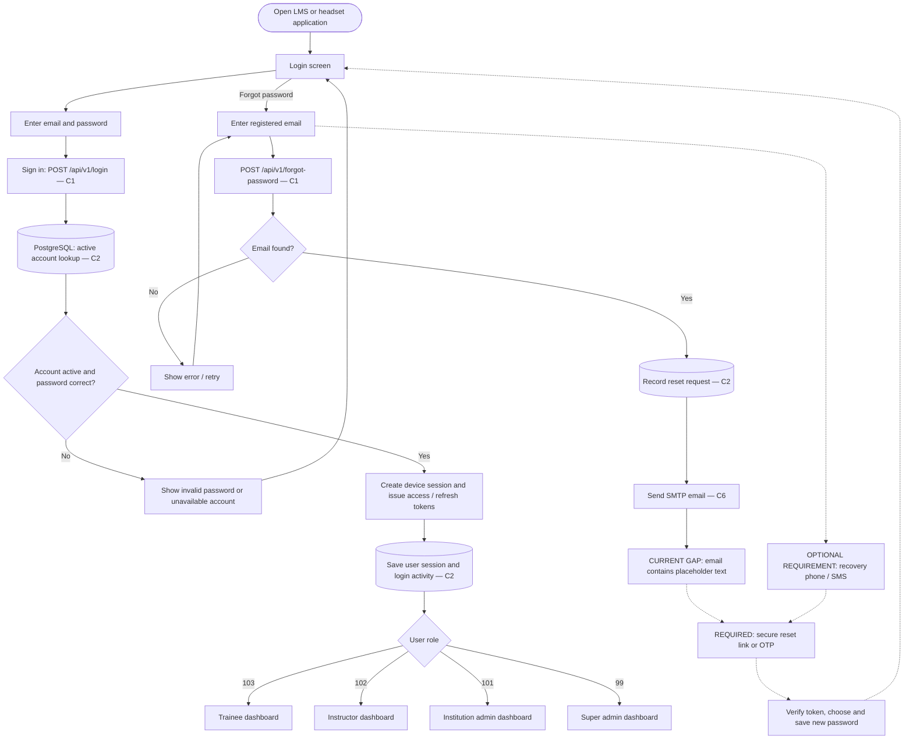
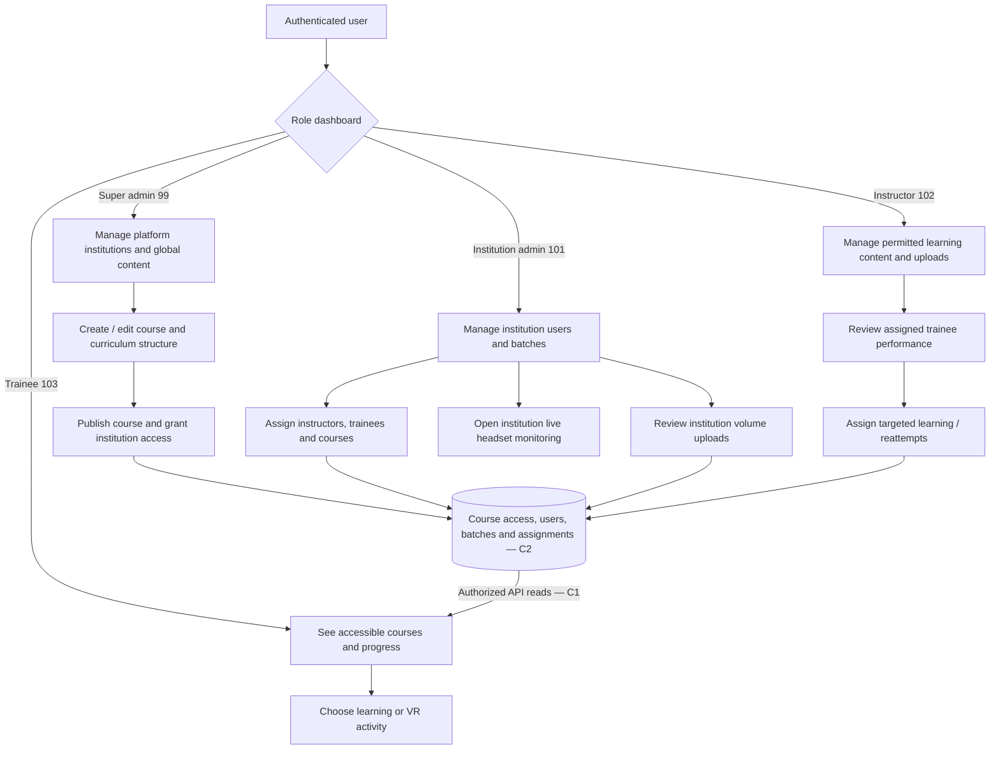
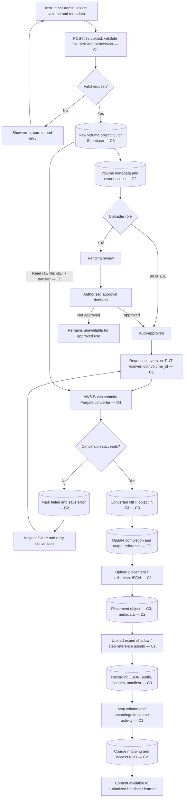
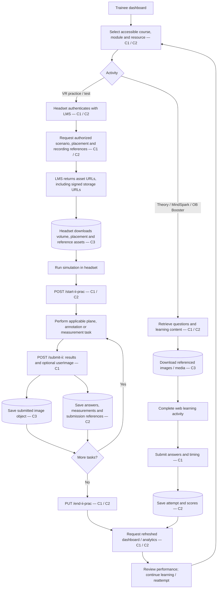
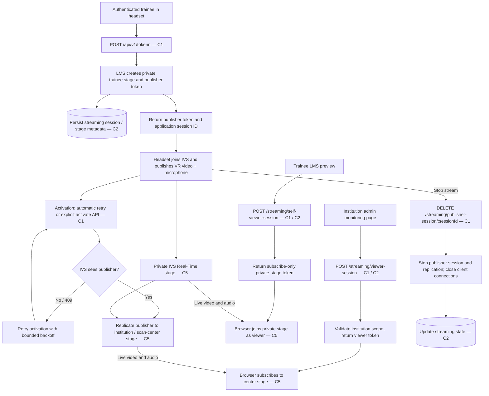

# Project ANU — User flows, headset communication and cloud costs

Reviewed: 30 October 2026. Based on the current `client`, `server/v1`, volume converter and tracked deployment configuration. This is a source review, not a verification of the running AWS account or Unity headset application. The repository includes the LMS side of the headset contract; headset-side caching, splash screens and offline behaviour cannot be confirmed here.

The attached images establish the requested presentation style. Their ultrasound AI/expert-voting flow and handwritten $0.03/GB example are reference material, not evidence that those features or prices exist in this project.

## Legend and cost labels

Solid arrows show implemented server/web paths. Dashed arrows show requested or illustrative behaviour that needs implementation or confirmation. Cylinders represent persistent cloud storage. Labels C1–C7 identify the cost incurred at that point; the cost table below explains each one. API responses return to the requesting browser/headset even where return arrows are omitted for readability.

The tracked Lambda template selects **S3 with Supabase fallback**; the generic storage adapter defaults to **Supabase** if no provider is set. Deployment configuration determines which is used. Do not count every object twice unless it actually exists in both providers.

## 1. Login, forgot password and role selection

**Recovery limitation:** `forgotpasswordcontroller.js` records a request and calls `smtp.js`, whose message is “Hello world?”. A complete secure password reset path was not found in this reviewed flow. Phone recovery is not implemented in this path. Account verification has separate request/verify endpoints; that does not establish a password-reset implementation. The forgot-password model also uses the legacy plaintext email lookup, whereas login uses the encrypted email lookup.

Evidence: `server/v1/Auth/authController.js`, `Auth/authModel.js`, `Auth/sessionStore.js`, `controller/forgotpasswordcontroller.js`, `model/forgotm.js`, `utils/smtp.js`, `routes/accountVerificationRoute.js`.

## 2. Role dashboards and administration

Each action remains subject to role, institution, ownership and assignment checks; a dashboard label does not imply access to every institution's data. Academic content follows curriculum → course → chapter → module → resources.

Evidence: `server/v1/Auth/authorization.js`, `Auth/volumeAuthorization.js`, `Auth/courseMappingAuthorization.js`, `routes/contentAccessRoute.js`, `model/contentAccessm.js`, `model/Batchm.js`, `model/reattm.js`.

## 3. Volume upload → conversion → headset-ready content

All abbreviated endpoints in this chart have prefix `/api/v1`. Uploads pass through the LMS backend in the reviewed routes; a direct presigned upload from headset/browser is not established by this flow. Reference recordings are uploaded files, distinct from the live IVS video stream.

Evidence: `server/v1/controller/volumeController.js`, `model/volumem.js`, `utils/storageAdapter.js`, `utils/startPythonProcess.js`, `routes/volumePlacementRoute.js`, `routes/volumeRecordingRoute.js`, `model/CourseMappingm.js`, `Vol-conversion/AWS_DEPLOYMENT.md`.

## 4. Trainee learning, headset downloads and result upload

Endpoints use `/api/v1`. The chart presents the logical journey; exact Unity screen order and simulation execution need headset-source verification. The start/end/submission endpoints above are the current route names, replacing the different names in the older project flowchart document. Browser and headset communicate through shared LMS APIs and persisted data. Asset downloads can go directly from storage to the client after URL delivery; video takes the separate IVS path below.

Evidence: `server/v1/routes/iivrStartTestRoute.js`, `routes/iivrEndTestRoute.js`, `routes/iivrRoutes.js`, `controller/iivrController.js`, `model/iivrm.js`, `utils/privateAssetUrls.js`, `utils/hydrateStorageFields.js`, `model/AnalyticsModel.js`, `APIs/Submit_MSOB_API_Product_Guide.md`.

## 5. Live headset → LMS viewing communication

Abbreviated streaming routes have prefix `/api/v1`. The documented center stage supports at most 12 concurrent replicated trainee publishers; quotas and actual deployed behaviour need operational verification. The reviewed current workflow establishes trainee self-preview and institution-admin monitoring. It does not establish instructor publishing/two-way mentoring or automatic archival of the live stream to S3. IVS media bypasses the LMS API after token issuance.

Evidence: `server/v1/STREAMING.md`, `routes/streamingSessionRoute.js`, `routes/tokenIvsRoute.js`, `services/streamingService.js`, `services/streamingPolicy.js`, `utils/ivsRealtime.js`.

## 6. Cloud storage and cost at each point

Prices are USD, before taxes, credits, free-tier allowances and negotiated discounts. Pricing references checked 30 October 2026. These are billing formulas, not a project invoice. Region-specific unit rates left as variables require the Mumbai calculator/account quote; the reference image's $0.03/GB is not adopted as a verified price.

| ID | Where it happens | Stored / transferred data | Cost at that point |
|---|---|---|---|
| C1 | Login, dashboard, upload, course lookup, test submission, stream-token and stop APIs | API requests and responses; backend execution | HTTP API requests × regional API rate + Lambda requests × rate + execution GB-seconds × Arm rate. Template allocates 2 GB, so execution GB-seconds = 2 × billed seconds. Every retry/poll adds usage. |
| C2 | Account lookup, login sessions, course mapping, progress, scores, analytics and streaming state | PostgreSQL rows and indexes | Database plan / compute + excess disk, backups and applicable egress. Shared monthly cost; no per-query price is established by the repository. Supabase Pro starts at $25/month, but the actual plan is unknown. |
| C3 | Raw upload, converted output, placement, reference recordings, learning media and submitted images | Persistent object bytes, PUT/GET requests and delivery to headset/browser | Average retained GB-month × storage rate + PUT requests × write rate + GET requests × read rate + billable outbound GB × egress rate. Upload ingress and retained storage are different billing dimensions. Provider fallback can add Supabase usage. |
| C4 | Each volume-conversion Batch job | Temporary raw/output files; CPU, RAM and scratch disk | For billed job hours h: h × (2 × vCPU-hour rate + 8 × GB-RAM-hour rate + 30 × extra scratch-GB-hour rate), plus object reads/writes, logs and networking. Tracked job requests 2 vCPU, 8 GiB RAM and 50 GiB temporary disk; 20 GB is included by Fargate. Batch orchestration has no additional service charge. |
| C5 | Headset publisher, trainee preview, admin viewer and replicated stages | Live video/audio; not inherently persistent storage | India first-tier video rate is $0.092 per participant-hour; audio-only $0.0092. Count connected publishers and viewers over time. Include replication-related billable usage according to IVS metering; validate it against account usage before estimating the full topology. |
| C6 | Forgot-password email and separate verification notifications | Email / notification delivery | SMTP provider plan + billable delivered messages; SMS would require an implemented provider and country-specific SMS charge. Current SMTP configuration does not establish a verified production tariff. |
| C7 | Supporting infrastructure across all flows | CloudWatch logs, Secrets Manager secrets, ECR images, frontend hosting, build output and network resources | Log ingestion/retention + secret storage/access + registry storage/builds + hosting + applicable public IPv4 / network transfer. These are shared overheads, not a charge to attach independently to every user action. |

Official pricing: [S3](https://aws.amazon.com/s3/pricing/), [Lambda](https://aws.amazon.com/lambda/pricing/), [HTTP API Gateway](https://aws.amazon.com/api-gateway/pricing/), [Fargate](https://aws.amazon.com/fargate/pricing/), [AWS Batch](https://aws.amazon.com/batch/pricing/), [IVS](https://aws.amazon.com/ivs/pricing/), [Supabase](https://supabase.com/pricing).

### Examples for reading the cost annotations

- **Storage:** if total retained raw + converted + recording + image assets average 100 GB for a month, object capacity cost is `100 × regional storage $/GB-month`. Uploading a 1 GB file once does not mean a one-time payment covers all future retention and downloads.
- **Downloads:** 100 trainees downloading a 0.5 GB scenario once produces 50 GB of outbound delivery, before retries and any caching. Add GET requests and the applicable egress allowance/tier.
- **Live session subtotal:** one headset publisher and one admin viewer connected for 30 minutes each produce 1 participant-hour, or **$0.092** at the India first tier. A simultaneous 30-minute trainee preview adds **$0.046**. These are connection subtotals; replication usage, APIs, database and overhead are additional.
- **Conversion:** for a 10-minute billed job, use `(10/60) × (2rCPU + 8rRAM + 30rDisk)` plus I/O and networking. Duration includes image pull until task termination under Fargate billing, rather than only the conversion algorithm's running time.

Monthly project total = API/backend + database + object storage/requests/egress + conversion jobs + IVS + notification provider + shared overhead. Required inputs for a numeric total: current provider/plan, retained asset sizes, retention, downloads, conversion duration/count, participant minutes by region, API count/runtime, and shared hosting/network resources.

## 7. Implementation boundaries to retain in the final requirements

1. Complete secure email reset and phone recovery are requested extensions; the reviewed reset email is a placeholder.
2. The first reference image's AI classification, expert consensus and majority voting are not established by the reviewed ANU LMS paths and are not included as implemented functionality.
3. Unity splash screen, asset cache, offline retry/synchronization and exact headset navigation need confirmation from the headset project.
4. Current streaming is private-stage publishing, replication, self-preview and institution-admin viewing. Automatic video recording and two-way mentoring need separate requirements and cost estimates.
5. Lambda deployment, EC2/container files and legacy Supabase support coexist in the repository. The tracked Lambda/S3/Batch configuration is the basis of this cost model; only deployed-resource inspection and billing data can confirm actual spend.

## Source index for review

| Flow | Primary repository evidence |
|---|---|
| Login | `server/v1/Auth/authController.js`, `server/v1/Auth/authModel.js`, `server/v1/Auth/sessionStore.js` |
| Recovery | `server/v1/controller/forgotpasswordcontroller.js`, `server/v1/model/forgotm.js`, `server/v1/utils/smtp.js` |
| Ownership / assignment | `server/v1/Auth/authorization.js`, `server/v1/Auth/volumeAuthorization.js`, `server/v1/model/contentAccessm.js` |
| Upload / conversion | `server/v1/controller/volumeController.js`, `server/v1/model/volumem.js`, `server/v1/utils/startPythonProcess.js` |
| Asset persistence / downloads | `server/v1/utils/storageAdapter.js`, `server/v1/utils/hydrateStorageFields.js` |
| Results | `server/v1/routes/iivrRoutes.js`, `server/v1/routes/iivrStartTestRoute.js`, `server/v1/routes/iivrEndTestRoute.js`, `server/v1/model/iivrm.js` |
| Streaming | `server/v1/STREAMING.md`, `server/v1/services/streamingService.js`, `server/v1/routes/streamingSessionRoute.js` |
| Cost resource sizing | `server/v1/template.yaml`, `terraform_/batch-job-definition.json`, `Vol-conversion/AWS_DEPLOYMENT.md` |
