# Project ANU — End-to-End User, Headset, LMS and Cloud Flow

## Purpose

This is the detailed flow requested for Project ANU. It shows the user journey, the communication between the web application, VR headset and LMS/backend, where data is stored, and where cloud cost is incurred.

> Cost figures below are cost categories and calculation points. Exact amounts depend on the AWS/Supabase region, plan, file sizes, session duration, number of learners and monthly traffic. They should be filled using the deployment's billing data before sharing a final commercial estimate.

## 0. Centralized role-to-system technical flow

The following is the central flow for the complete platform. All roles enter through the same authentication and authorization layer, then reach only the modules permitted for their role.

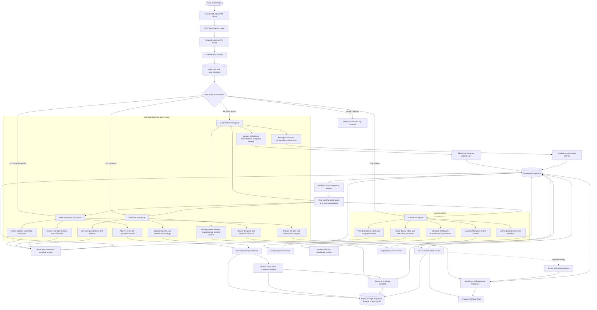

## Role permissions

| Role | Main responsibility | Main technical modules |
|---|---|---|
| Super Admin (`99`) | Platform-wide governance | Institutions, administrators, curriculum, certifications, global volumes, course mapping, content access, reattempt oversight |
| Institution Admin (`101`) | Institution operations | Batches, instructors, trainees, schedules, approvals, institutional streams, progress monitoring |
| Instructor (`102`) | Teaching and assessment | Assigned batches, trainee review, volume upload, reference recordings, supervision, performance feedback |
| Trainee (`103`) | Learning and simulation | Dashboard, assigned courses, theory, MindSpark, VR practice/tests, queries, progress and feedback |

## 0.1 Role-independent authentication and authorization flow

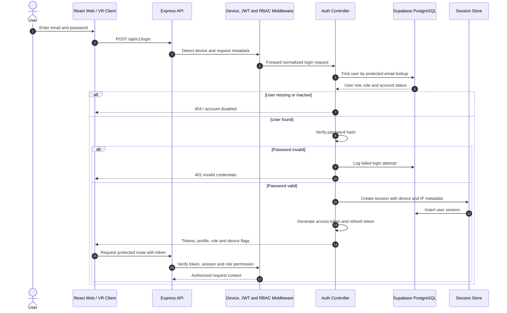

## 0.2 Shared data and service architecture

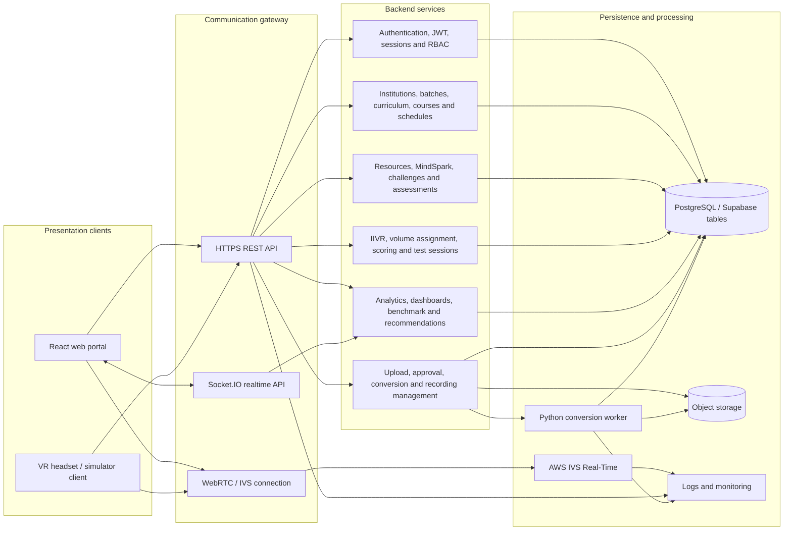

## 0.3 Complete platform lifecycle

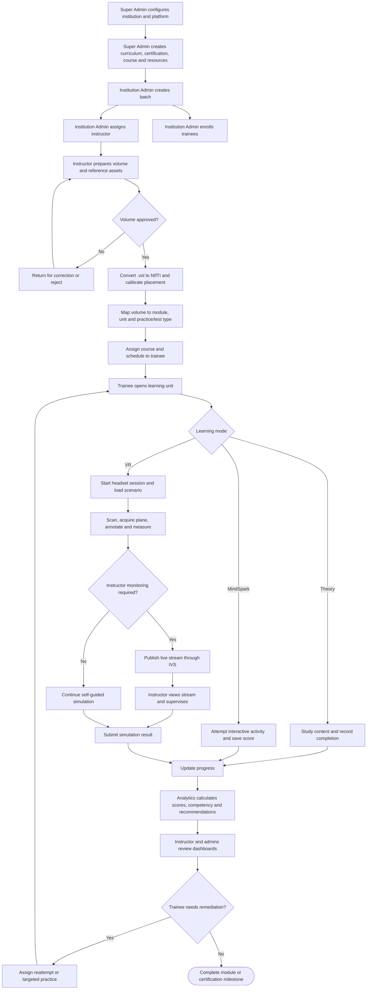

## 1. Main trainee journey

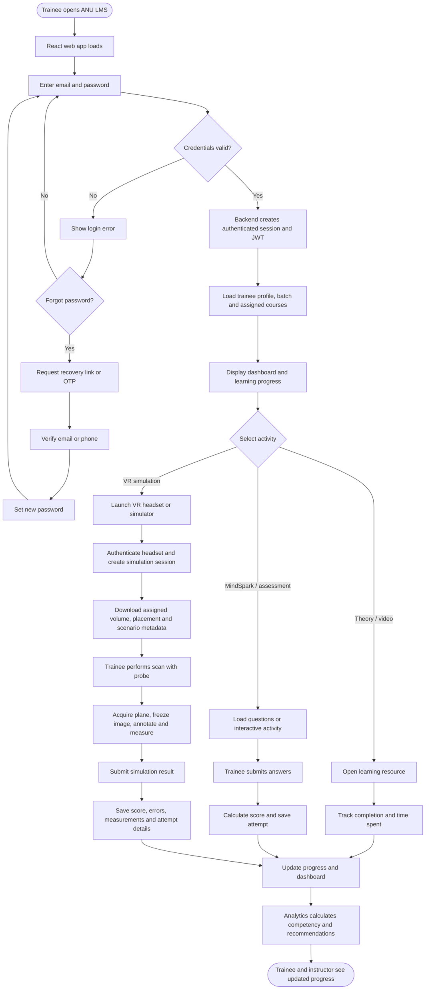

## 1.1 Super Admin technical flow

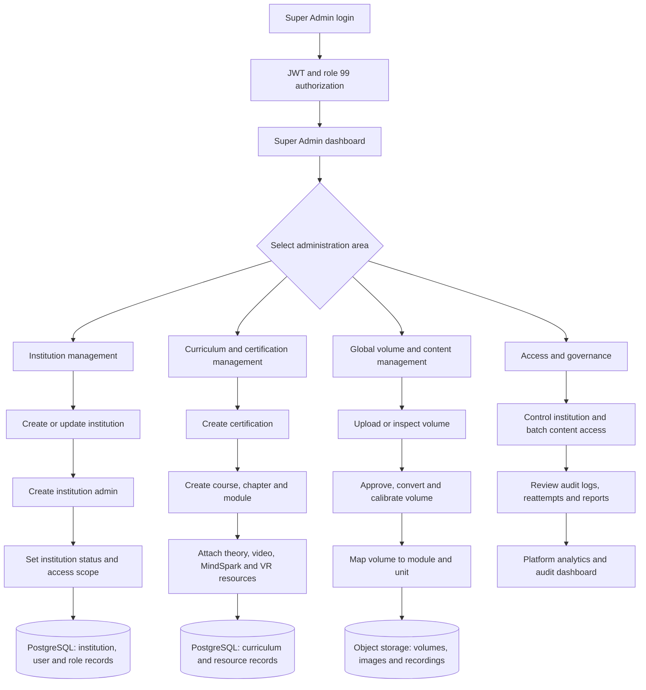

## 1.2 Institution Admin technical flow

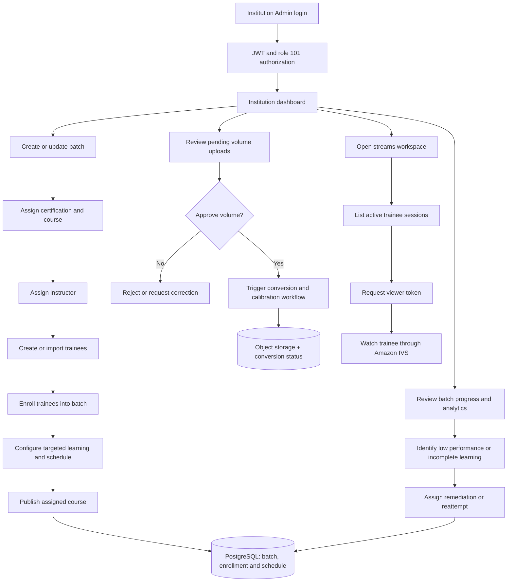

## 1.3 Instructor technical flow

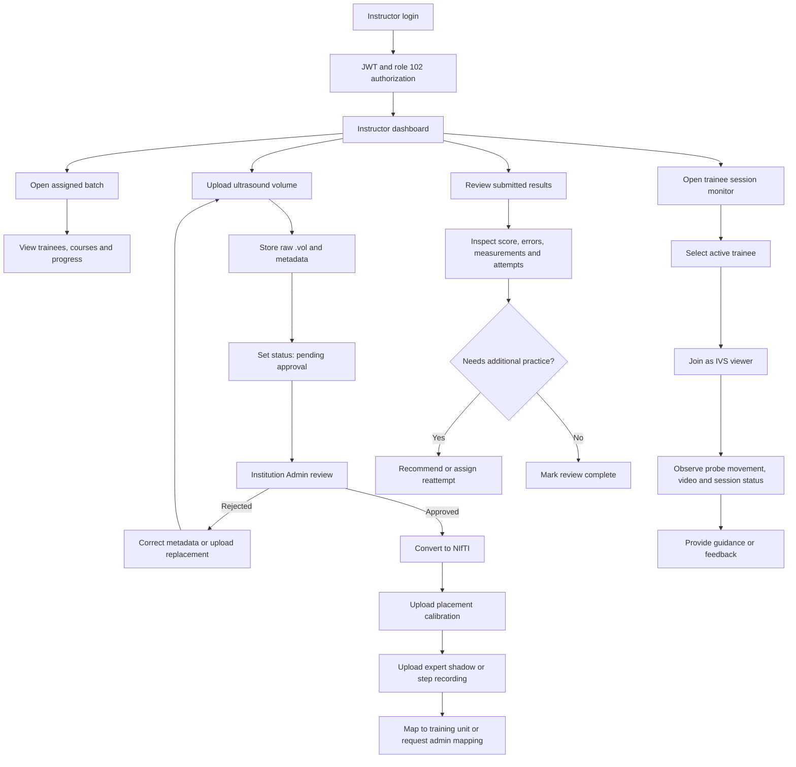

## 1.4 Trainee technical flow

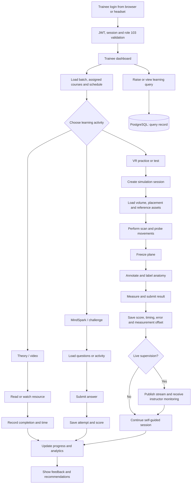

## 2. System and cloud communication flow

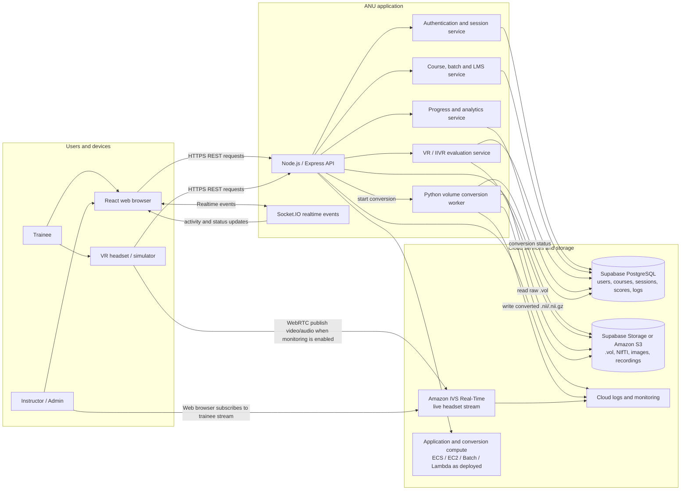

## 3. Detailed VR simulation flow

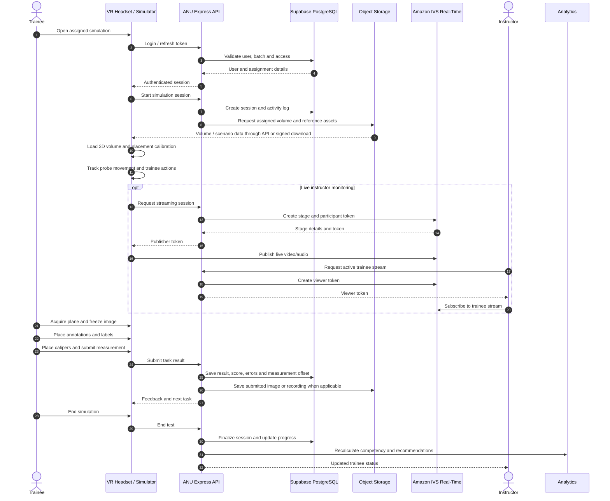

## 4. Content and volume preparation flow

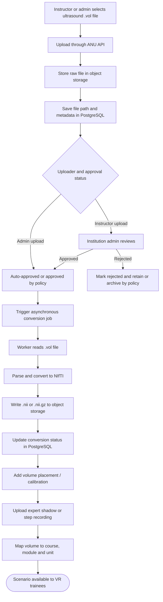

## 5. Cloud cost points

| Flow point | What is stored or consumed | Cloud cost to measure | Cost driver |
|---|---|---|---|
| Login and LMS API calls | Authentication requests, course and dashboard API calls | Application compute, API requests and logs | Number of requests and execution time |
| PostgreSQL database | Users, batches, courses, sessions, scores, activity logs | Supabase plan/database usage | Database size, connections and query volume |
| Raw volume upload | GE Kretz `.vol` files | Object storage capacity and upload requests | File size and number of uploaded volumes |
| NIfTI conversion | CPU/memory used by Python worker | EC2/ECS/Batch/Lambda compute | Conversion duration and file size |
| Converted volume download | `.nii`/`.nii.gz` delivered to headset | Object-storage download and data transfer | Number of simulations and volume size |
| Submitted results | Images, annotations, recordings and reports | Object storage and database writes | Attempts, retention and media size |
| Realtime activity | Progress/status events through Socket.IO | Application compute, realtime service and logs | Connected users and event volume |
| Live tele-mentoring | Headset video/audio sent to instructor | Amazon IVS stage, participant and data usage | Stream duration, publishers, viewers and region |
| Monitoring and troubleshooting | Application, worker and streaming logs | Cloud logging and metrics | Log volume and retention period |

## 6. Cost-estimation template

Use this section with actual monthly usage assumptions:

```text
Monthly cloud cost
= application/API compute
+ database/Supabase plan
+ object storage for raw and converted volumes
+ object-storage requests and downloads
+ volume-conversion compute
+ realtime communication
+ Amazon IVS live streaming
+ data transfer
+ logs and monitoring
```

Recommended assumptions to fill in before final pricing:

- Number of registered trainees and instructors.
- Average monthly active trainees.
- Average VR sessions per trainee and average session duration.
- Average `.vol` and NIfTI file size.
- Number of new volumes uploaded per month.
- Whether old volumes, recordings and logs are retained indefinitely.
- Number of simultaneous instructor monitoring sessions.
- AWS and Supabase regions/plans.

## Notes and implementation assumptions

- The repository shows Supabase/PostgreSQL for application data, object storage integrations for volume/media assets, an Express backend, a Python volume-conversion workload, Socket.IO activity updates and Amazon IVS Real-Time for live streaming.
- The exact storage provider for each object should be confirmed in deployment configuration. The flow therefore labels it “Supabase Storage or Amazon S3” where the repository supports both patterns.
- Cloud costs should be shown as separate line items. In particular, IVS streaming and volume conversion can vary substantially with usage and should not be hidden inside a generic API cost.
